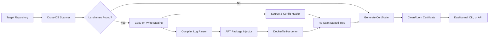

# WorksOnMyMachine

**Autonomous Cross-OS (Windows/macOS-to-Linux) Reproducibility Scanner, Compiler `apt` Auto-Healer & Merkle Certification Engine.**

<p align="center">
  
  
  
</p>
<p align="center">
  
  
  
</p>

[Overview](#overview) · [What It Heals](#what-breaks-vs-how-it-heals) · [Architecture](#system-architecture) · [Quickstart](#quickstart) · [Web UI & CLI](#web-dashboard--cli) · [API Reference](#api-reference) · [Demo Targets](#demo-targets) · [Docker & Testing](#docker--testing)

---

## Overview

**WorksOnMyMachine** is an offline-first cross-platform reproducibility platform for projects that run on a developer workstation (Windows or macOS) but fail when rebuilt in a clean Linux environment.

Cross-platform builds routinely break due to case-sensitive Linux filesystems (`ext4`), hardcoded Windows backslashes (`\`), `CRLF` shell script line endings, unpinned dependencies, and missing native C/Rust system headers (`Python.h`, `pg_config`, `libGL.so.1`, `ffi.h`).

WorksOnMyMachine solves this automatically without executing untrusted target code:

1. **Scans** repositories statically for cross-OS portability landmines.
2. **Diagnoses** compiler failure logs and maps missing headers/libraries to exact Debian/Ubuntu `apt` packages.
3. **Auto-Heals** source imports, paths, shell scripts, `.env.example` drift, and `Dockerfile` layers in an isolated copy-on-write staging sandbox.
4. **Certifies** deterministic builds using metadata-independent SHA-256 Merkle trees.

> **100% Offline-First & Safe by Design:** WorksOnMyMachine never executes target repository code and never overwrites your source files in-place. All repairs happen in an isolated staging directory and produce standard unified Git diffs.

---

## What Breaks vs. How It Heals

| What Breaks on Clean Linux                                                                                | How WorksOnMyMachine Heals It                                                                                                        |
| :-------------------------------------------------------------------------------------------------------- | :----------------------------------------------------------------------------------------------------------------------------------- |
| **`ImportError` on Case-Sensitive Linux (`ext4`)** — `from utils.DataLoader` when file is `dataloader.py` | Enumerates directory entries segment-by-segment without trusting the host OS and rewrites imports to match exact disk casing.        |
| **Hardcoded Windows & Host Paths** — `C:\Users\Dev\models\weights.bin` or `data\\cache\\items.json`       | Detects OS-specific path literals and normalizes them into portable project-relative POSIX paths.                                    |
| **Broken Shell Entrypoints (`/bin/sh^M`)** — `entrypoint.sh` has `CRLF` endings or no shebang             | Reads shell bytes directly, converts `CRLF` to `LF`, adds a portable shebang, and applies execute permissions in staging.            |
| **Native Compiler & Shared Library Failures** — Missing `Python.h`, `ffi.h`, `pg_config`, or `libGL.so.1` | Maps compiler/runtime signatures to deterministic Debian/Ubuntu `apt` packages.                                                      |
| **Unpinned & Insecure Dockerfiles** — `FROM python:latest` and root execution                             | Pins the base image to `python:3.11.9-slim`, consolidates the `apt` layer, cleans `apt` metadata, and enforces a non-root `appuser`. |
| **Unpinned Dependencies** — Floating ranges in `requirements.txt` or stale lock evidence                  | Scores dependency determinism and pins packages to known-good deterministic versions.                                                |
| **Cross-Host Hash Drift** — Different timestamps (`mtime`), inodes, or line endings across OSes           | Normalizes text line endings in memory and computes a metadata-independent SHA-256 Merkle root.                                      |

---

## System Architecture

### The Healing Loop



### Component Stack

```text
                       +----------------------------------+
                       | CleanRoom Dashboard              |
                       | local SVG / CSS / JavaScript     |
                       +----------------+-----------------+
                                        |
                       +----------------v-----------------+
                       | FastAPI Application              |
                       | scan | parse | heal | certify    |
                       | compare | audit                  |
                       +----------------+-----------------+
                                        |
        +-------------------------------+-------------------------------+
        |                               |                               |
+-------v--------+             +--------v---------+             +-------v----------+
| Landmine       |             | Compiler &       |             | Reproducibility  |
| Scanner        |             | Docker Healer    |             | Engine           |
| AST + Rules    |             | Offline APT Map  |             | Merkle + Certs   |
+----------------+             +------------------+             +------------------+
```

---

## Quickstart

### Requirements

- **Python 3.11.9** (pinned in `.python-version` and `runtime.txt`)
- **Docker** *(optional, for containerized execution)*

### 1. Clone & Install

**Linux / macOS / WSL:**

```bash
git clone <repository-url> WorksOnMyMachine
cd WorksOnMyMachine
python3.11 -m venv .venv
. .venv/bin/activate
python -m pip install --requirement requirements.txt
cp .env.example .env
```

**Windows (PowerShell):**

```powershell
git clone <repository-url> WorksOnMyMachine
cd WorksOnMyMachine
python -m venv .venv
.venv\Scripts\Activate.ps1
python -m pip install --requirement requirements.txt
Copy-Item .env.example .env
```

### 2. Run the Dashboard and API

```bash
python -m uvicorn --app-dir src worksonmymachine.app:app --host 127.0.0.1 --port 8000
```

- **Interactive Web Dashboard:** `http://127.0.0.1:8000/`
- **OpenAPI Documentation:** `http://127.0.0.1:8000/docs`

---

## Web Dashboard & CLI

### Self-Contained Cyber-Engineering Dashboard

The web UI serves local HTML, CSS, JavaScript, and custom inline SVG graphics with zero external CDNs or network calls:

- **Animated SVG Radial Gauges:** Live Before-vs-After readiness and dependency lock telemetry.
- **Cross-OS Landmine Radar:** Filterable issue table with severity badges and POSIX file/line locations.
- **Compiler-to-APT & Dockerfile Viewer:** Side-by-side and unified diff views for hardened Dockerfiles.
- **Interactive SVG Merkle Graph:** Visual node-link tree of file SHA-256 digests and downloadable JSON certificates.
- **Workspace-relative targets:** The dashboard audits the current repository by default and accepts any normalized repository path inside the workspace, such as `projects/api-service`.

### CLI Commands

```bash
PYTHONPATH=src python -m worksonmymachine --help
PYTHONPATH=src python -m worksonmymachine scan nightmare_ml_service
PYTHONPATH=src python -m worksonmymachine parse-log nightmare_ml_service
PYTHONPATH=src python -m worksonmymachine certify nightmare_ml_service --json
PYTHONPATH=src python -m worksonmymachine heal nightmare_ml_service --json
```

When installed as a package in your virtual environment, you can also run:

```bash
worksonmymachine scan nightmare_ml_service
```

---

## API Reference

| Method | Endpoint                  | Description                                            |
| :----- | :------------------------ | :----------------------------------------------------- |
| `GET`  | `/`                       | Serve the local CleanRoom Web Dashboard                |
| `GET`  | `/health`                 | Service health check                                   |
| `GET`  | `/api/v1/targets`         | List configured fixture targets                        |
| `GET`  | `/api/v1/targets?scope=workspace` | List the current workspace and repository candidates |
| `POST` | `/api/v1/scan`            | Scan repository for cross-OS portability landmines     |
| `POST` | `/api/v1/parse-log`       | Parse a target or raw compiler error log               |
| `POST` | `/api/v1/heal`            | Heal source and configuration files in staging         |
| `POST` | `/api/v1/heal-dockerfile` | Harden a staged `Dockerfile` and inject `apt` packages |
| `POST` | `/api/v1/certify`         | Generate a deterministic SHA-256 Merkle certificate    |
| `POST` | `/api/v1/compare`         | Compare certificate drift between snapshots            |
| `POST` | `/api/v1/audit`           | Run the unified scan, heal, and certification workflow |

### Example API Calls

```bash
# Run a unified auto-heal audit against the current repository
curl --request POST http://127.0.0.1:8000/api/v1/audit \
  --header 'Content-Type: application/json' \
  --data '{"target":"workspace","auto_heal":true}'

# Audit another repository located below this workspace
curl --request POST http://127.0.0.1:8000/api/v1/audit \
  --header 'Content-Type: application/json' \
  --data '{"target":"projects/api-service","auto_heal":true}'

# Parse a raw compiler failure string
curl --request POST http://127.0.0.1:8000/api/v1/parse-log \
  --header 'Content-Type: application/json' \
  --data '{"log_text":"fatal error: Python.h: No such file or directory"}'
```

---

## Demo Targets

The `demo_targets/` directory contains three broken sample repositories used for automated testing and 1-click demos:


- **`nightmare_ml_service`** — Hardcoded Windows paths (`C:\Users\Dev\...`), backslash path separators, missing `.env.example` keys, `CRLF` shell script without a shebang, an unpinned `python:latest` image running as root, and simulated `Python.h`, `pg_config`, and `libGL.so.1` failures.
- **`case_sensitive_webapp`** — Python and JavaScript import casing mismatches that work on Windows/macOS but fail on Linux `ext4`, unpinned requirements, and a floating Docker base image.
- **`rust_crypto_worker`** — Native `libffi` and OpenSSL header failures (`ffi.h`, `openssl/ssl.h`), missing Rust/Cargo toolchain errors, and a broken hybrid build setup.

---

## Docker & Testing

### Build and Run with Docker

```bash
docker build --tag worksonmymachine:latest .
docker run --rm --publish 8000:8000 worksonmymachine:latest
```

### Run the Offline Test Suite

```bash
python -m pytest
```

Or via `Makefile`:

```bash
make test
```

---

## Project Layout

```text
src/worksonmymachine/
├── app.py          FastAPI application and API routes
├── scanner.py      Cross-OS landmine scanner and source healer
├── apt_healer.py   Compiler parser and Dockerfile apt healer
├── repro_hash.py   Merkle hashing, certificates, and audit orchestration
├── cli.py          Click and Rich command-line interface
└── static/         Self-contained dashboard and custom SVG engine
tests/              Foundation, scanner, apt, Merkle, CLI, and E2E UI tests
demo_targets/       Intentionally broken sample repositories
```

## License

WorksOnMyMachine is released under the [MIT License](LICENSE).

## Configuration

Copy `.env.example` to `.env` for local overrides:

```dotenv
APP_HOST=0.0.0.0
APP_PORT=8000
LOG_LEVEL=INFO
STRICT_REPRO_MODE=true
SANDBOX_DIR=./demo_targets
LLM_API_KEY=
LLM_MODEL=gpt-4o-mini
```

All core features and tests run 100% offline without `LLM_API_KEY`.
