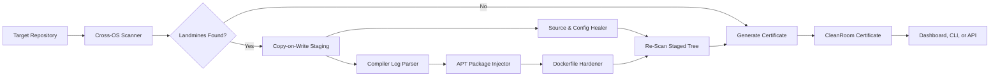

<p align="center">  
    
</p>

<h1 align="center">WorksOnMyMachine</h1>

<p align="center">
  Autonomous cross-platform reproducibility scanner, multi-distro package auto-healer, and Merkle certification engine.
</p>

<p align="center">
  <a href="#docker--testing"></a>
  
  
  
  
  <a href="LICENSE"></a>
</p>

---

**WorksOnMyMachine** is an offline-first cross-platform reproducibility platform built for developers, DevOps, and QA teams whose code runs smoothly on a developer workstation (Windows or macOS) but repeatedly breaks in clean Linux environments (`ext4`), CI/CD runners, and Docker builds.

Instead of guessing why your build broke, **WorksOnMyMachine** statically scans your codebase for cross-OS landmines, parses compiler errors to automatically inject required system packages across Debian/Ubuntu (`apt`), Alpine (`apk`), and Fedora/RHEL/CentOS (`dnf`), normalizes paths and shell scripts, and produces cryptographically verifiable CleanRoom build certificates—**100% offline with zero code execution**.

> [!IMPORTANT]
> **Safe by Design & Copy-on-Write:** WorksOnMyMachine never executes untrusted code from scanned repositories and never modifies files in-place without explicit confirmation (`--apply`). All repairs happen in an isolated copy-on-write staging sandbox and generate standard unified Git diffs.

## Why WorksOnMyMachine?

Every time code leaves a local workstation for a clean Linux runner, subtle platform differences cause build and runtime failures:

- 🗂️ **Case-Sensitive Linux (`ext4`) Failures:** Windows and macOS filesystems are case-insensitive. An import like `from utils.DataLoader import model` when the file is named `dataloader.py` works locally but immediately crashes on Linux with `ModuleNotFoundError`. WorksOnMyMachine enumerates disk entries segment-by-segment to repair casing.
- 🧩 **Cryptic Missing C/Rust/Node.js System Headers:** Native builds explode with `fatal error: Python.h: No such file or directory`, missing `libpq-dev`, `libGL.so.1`, or Node.js native addon build errors (`sharp` needing `libvips-dev`, `canvas` requiring `libcairo2-dev`, `node-gyp` missing C++ tools). WorksOnMyMachine maps compiler failures directly to exact native packages across Debian/Ubuntu (`apt-get`), Alpine (`apk`), and Fedora/RHEL (`dnf`).
- 🪟 **Hardcoded Windows Paths & Backslashes:** Hardcoded paths (`C:\Users\...` or `models\\weights.bin`) break immediately in Linux containers. WorksOnMyMachine normalizes them into portable project-relative POSIX paths.
- 📜 **Corrupted Shell Line Endings & Missing Git Permissions (`+x`):** Scripts saved with Windows `CRLF` fail to execute on Linux (`/bin/sh^M`). Worse, Windows ignores POSIX file modes, leaving shell scripts tracked in Git as mode `100644`. WorksOnMyMachine normalizes line endings and inspects Git index metadata to recommend `git update-index --chmod=+x`.
- 📦 **Modern Python Packaging & Lockfile Drift:** Validates PEP 621 `pyproject.toml`, Poetry dependency groups, Pipenv, and verifies structural lock coverage across `uv.lock`, `poetry.lock`, `Pipfile.lock`, and `requirements.lock` completely offline.
- 🐳 **Vulnerable, Unpinned Dockerfiles:** `FROM python:latest` running as `root` causes security audit failures and broken builds when upstream images update. WorksOnMyMachine hardens base images using runtime-aware base tags (Python, Rust, Node.js, Ubuntu, Alpine), consolidates package layers, and enforces non-root execution.
- 🔒 **Cross-OS Build Drift:** Timestamps (`mtime`), line endings, and file ordering create divergent build hashes. WorksOnMyMachine computes a metadata-independent SHA-256 Merkle tree to verify bit-for-bit reproducibility.

## Table of Contents

- [Why WorksOnMyMachine?](#why-worksonmymachine)
- [Features & What It Heals](#features--what-it-heals)
- [System Architecture](#system-architecture)
- [Installation & Quickstart](#installation--quickstart)
- [Usage](#usage)
  - [Web Dashboard](#web-dashboard)
  - [CLI Quick Reference](#cli-quick-reference)
  - [Safe CLI Apply Mode](#safe-cli-apply-mode)
  - [Pre-Commit Hook](#pre-commit-hook)
  - [GitHub Actions CI](#github-actions-ci)
- [Configuration](#configuration)
- [API Reference](#api-reference)
- [Demo Targets](#demo-targets)
- [Project Structure](#project-structure)
- [Docker & Testing](#docker--testing)
- [License](#license)

---

## Features & What It Heals

| What Breaks on Clean Linux                                                                                | How WorksOnMyMachine Heals It                                                                                                        |
| :-------------------------------------------------------------------------------------------------------- | :----------------------------------------------------------------------------------------------------------------------------------- |
| **`ImportError` on Case-Sensitive Linux (`ext4`)** — `from utils.DataLoader` when file is `dataloader.py` | Enumerates directory entries segment-by-segment without trusting the host OS and rewrites imports to match exact disk casing.        |
| **Hardcoded Windows & Host Paths** — `C:\Users\Dev\models\weights.bin` or `data\\cache\\items.json`       | Detects OS-specific path literals and normalizes them into portable project-relative POSIX paths.                                    |
| **Broken Shell Entrypoints & Git Permissions** — `entrypoint.sh` has `CRLF` endings or Git mode `100644`  | Converts `CRLF` to `LF`, adds portable shebangs, and inspects Git index metadata to recommend `git update-index --chmod=+x`.        |
| **Native Compiler & Node.js Addon Failures** — Missing `Python.h`, `ffi.h`, `pg_config`, `sharp` (`libvips`), or `canvas` (`cairo`) | Maps compiler/runtime signatures to native packages across Debian/Ubuntu (`apt`), Alpine (`apk`), and Fedora/RHEL (`dnf`).          |
| **Unpinned & Insecure Dockerfiles** — `FROM python:latest` and root execution                             | Pins base image preserving runtime families (`python:3.11.9-slim`, `rust:1.85-slim-bookworm`, `node:22-bookworm-slim`, `ubuntu:24.04`, `alpine:3.20`), consolidates package layers, cleans package metadata, and enforces a non-root `appuser`. |
| **Modern Python Packaging & Lock Drift** — Floating dependencies in `pyproject.toml`, Poetry, or Pipenv  | Scores dependency determinism and validates lockfile coverage across `uv.lock`, `poetry.lock`, `Pipfile.lock`, and `requirements.lock`. |
| **TypeScript / JS Directory Imports** — `import from './components'` failing casing resolution            | Resolves across `index.ts`, `index.tsx`, `index.js`, `index.jsx`, `index.mjs`, and `index.cjs`.                                      |
| **Nested & Multi-Stage Dockerfiles** — Dockerfiles in `docker/`, `deploy/`, or `.devcontainer/`           | Recursively discovers and hardens nested Dockerfiles alongside root containers.                                                      |
| **Cross-Host Hash Drift** — Different timestamps (`mtime`), inodes, or line endings across OSes           | Normalizes text line endings in memory and computes a metadata-independent SHA-256 Merkle root.                                      |

---

## System Architecture

### The Healing Loop



### Component Stack

```text
                       +----------------------------------+
                       | CleanRoom Dashboard              |
                       | local SVG / CSS / JavaScript     |
                       +----------------+-----------------+
                                        |
                       +----------------v-----------------+
                       | FastAPI Application              |
                       | scan | parse | heal | certify    |
                       | compare | audit                  |
                       +----------------+-----------------+
                                        |
        +-------------------------------+-------------------------------+
        |                               |                               |
+-------v--------+             +--------v---------+             +-------v----------+
| Landmine       |             | Compiler &       |             | Reproducibility  |
| Scanner        |             | Docker Healer    |             | Engine           |
| AST + Rules    |             | Offline APT Map  |             | Merkle + Certs   |
+----------------+             +------------------+             +------------------+
```

---

## Installation & Quickstart

### Requirements

- **Python 3.11.9** (pinned in `.python-version` and `runtime.txt`)
- **Docker** *(optional, for containerized execution)*

### 1. Clone & Install

**Linux / macOS / WSL:**

```bash
git clone https://github.com/markr/WorksOnMyMachine.git
cd WorksOnMyMachine
python3.11 -m venv .venv
. .venv/bin/activate
python -m pip install --requirement requirements.txt
cp .env.example .env
```

**Windows (PowerShell):**

```powershell
git clone https://github.com/markr/WorksOnMyMachine.git
cd WorksOnMyMachine
python -m venv .venv
.venv\Scripts\Activate.ps1
python -m pip install --requirement requirements.txt
Copy-Item .env.example .env
```

### 2. Run the Dashboard and API

```bash
python -m uvicorn --app-dir src worksonmymachine.app:app --host 127.0.0.1 --port 8000
```

- **Interactive Web Dashboard:** `http://127.0.0.1:8000/`
- **OpenAPI Documentation:** `http://127.0.0.1:8000/docs`

---

## Usage

### Web Dashboard

The web UI serves local HTML, CSS, JavaScript, and custom inline SVG graphics with **zero external CDNs or network calls**:

- **Animated SVG Radial Gauges:** Live Before-vs-After readiness and dependency lock telemetry.
- **Cross-OS Landmine Radar:** Filterable issue table with severity badges and POSIX file/line locations.
- **Compiler-to-APT & Dockerfile Viewer:** Side-by-side and unified diff views for hardened Dockerfiles.
- **Interactive SVG Merkle Graph:** Visual node-link tree of file SHA-256 digests and downloadable JSON certificates.
- **Workspace-relative targets:** Audits the current repository by default and accepts any normalized repository path inside the workspace.
- **Opt-in staged build verification:** The Build & Deploy drawer can run Docker against a temporary healed copy and reports status without mutating source.
- **Local audit history and issue evidence:** Completed runs persist in browser storage with bounded source context, remediation, and raw evidence.

### CLI Quick Reference

| Goal                                       | Command                                                                                 |
| :----------------------------------------- | :-------------------------------------------------------------------------------------- |
| **Scan repository statically**             | `worksonmymachine scan <target>`                                                        |
| **Auto-heal & generate Git patch**         | `worksonmymachine audit <target> --auto-heal --format patch --output fix.patch`         |
| **Diagnose compiler error log**            | `worksonmymachine parse-log <target_or_logfile>`                                        |
| **Generate Merkle certificate**            | `worksonmymachine certify <target> --output certificate.json`                           |
| **CI policy gate (fail on high severity)** | `worksonmymachine check <target> --fail-on high`                                        |
| **CI gate (baseline / new findings only)** | `worksonmymachine check <target> --new-only --baseline .worksonmymachine-baseline.json` |
| **Export SARIF for GitHub Code Scanning**  | `worksonmymachine audit <target> --format sarif --output audit.sarif`                   |
| **Apply healed changes to workspace**      | `worksonmymachine apply <target> --yes`                                                 |
| **Live watch mode (auto-rescan on edit)**  | `worksonmymachine watch .`                                                              |


### Safe CLI Apply Mode

By default, WorksOnMyMachine **never** touches your working tree. When you are ready to apply verified fixes (such as path normalizations, import casing corrections, and Dockerfile hardening) directly into your workspace:

```bash
# Preview changes with interactive confirmation prompt
worksonmymachine apply workspace

# Apply immediately without confirmation prompt (CI / automated scripts)
worksonmymachine apply workspace --yes
```

WorksOnMyMachine creates an atomic pre-apply backup before writing files, verifies the target directory remains safe, and writes all repaired files atomically.

### Pre-Commit Hook

Add WorksOnMyMachine to your project's `.pre-commit-config.yaml` to prevent cross-OS regressions before commits are created:

```yaml
repos:
  - repo: https://github.com/markr/WorksOnMyMachine
    rev: v1.0.0
    hooks:
      - id: worksonmymachine-check
        args: [--fail-on, high]
```

The hook scans the caller repository root (`--root .`) in read-only mode without receiving staged filenames. Configure additional CLI policy arguments under `args` as needed.

### GitHub Actions CI

#### Option 1: Official GitHub Action (Recommended)

WorksOnMyMachine ships an official composite action in `action.yml`:

```yaml
name: Reproducibility Guard

on: [push, pull_request]

jobs:
  check:
    runs-on: ubuntu-latest
    steps:
      - uses: actions/checkout@v4
      - name: WorksOnMyMachine Check
        id: reproducibility
        uses: markr/WorksOnMyMachine@v1
        with:
          fail-on: high
          min-readiness: '80'
          new-only: 'true'
          baseline: .worksonmymachine-baseline.json
          output: artifacts/worksonmymachine.sarif

      - name: Upload SARIF to GitHub Code Scanning
        if: always()
        uses: github/codeql-action/upload-sarif@v3
        with:
          sarif_file: ${{ steps.reproducibility.outputs.report-path }}
```

#### Option 2: Custom Workflow Step

```yaml
# .github/workflows/reproducibility.yml
name: Cross-OS Reproducibility Guard

on:
  push:
    branches: [main, master]
  pull_request:
    branches: [main, master]

jobs:
  check-portability:
    runs-on: ubuntu-latest
    steps:
      - name: Checkout Code
        uses: actions/checkout@v4

      - name: Set up Python
        uses: actions/setup-python@v5
        with:
          python-version: "3.11"

      - name: Install WorksOnMyMachine
        run: pip install .

      - name: Run Reproducibility Check
        run: |
          worksonmymachine check workspace \
            --format sarif \
            --output results.sarif \
            --fail-on high

      - name: Upload SARIF to GitHub Code Scanning
        uses: github/codeql-action/upload-sarif@v3
        if: always()
        with:
          sarif_file: results.sarif
```

---

## Configuration

### Workspace Configuration (`.worksonmymachine.toml`)

The optional `.worksonmymachine.toml` file controls workspace-relative targets, ignored directories, and suppressions:

```toml
target_paths = ["workspace"]
ignore_paths = ["vendor", "generated"]
build_command = "docker build -t api-service ."
test_command = "pytest -q"
runtime = "python:3.11"

[policy]
fail_on = "high"
min_readiness = 90.0
require_reproducible = true
allow_floating_docker_tags = false
require_lockfiles = true

[[suppressions]]
issue_id = "REQ-UNPINNED"
path = "legacy/requirements.txt"
reason = "Managed by the platform dependency service"
expires = "2027-01-01"
```

### Environment Variables (`.env`)

Copy `.env.example` to `.env` for local overrides:

```dotenv
APP_HOST=0.0.0.0
APP_PORT=8000
LOG_LEVEL=INFO
STRICT_REPRO_MODE=true
SANDBOX_DIR=./demo_targets
LLM_API_KEY=
LLM_MODEL=gpt-4o-mini
ALLOW_CONFIGURED_BUILD_COMMANDS=false
```

Configured build and test commands are disabled for API requests by default.
Set `ALLOW_CONFIGURED_BUILD_COMMANDS=true` only when the service is trusted and
the workspace configuration is controlled by the operator.

All core features and tests run **100% offline without `LLM_API_KEY`**.

---

## API Reference

| Method | Endpoint                          | Description                                                                   |
| :----- | :-------------------------------- | :---------------------------------------------------------------------------- |
| `GET`  | `/`                               | Serve the local CleanRoom Web Dashboard                                       |
| `GET`  | `/health`                         | Service health check                                                          |
| `GET`  | `/api/v1/targets`                 | List configured fixture targets                                               |
| `GET`  | `/api/v1/targets?scope=workspace` | List the current workspace and repository candidates                          |
| `POST` | `/api/v1/scan`                    | Scan repository for cross-OS portability landmines                            |
| `POST` | `/api/v1/parse-log`               | Parse a target or raw compiler error log                                      |
| `POST` | `/api/v1/heal`                    | Heal source and configuration files in staging                                |
| `POST` | `/api/v1/heal-dockerfile`         | Harden a staged `Dockerfile` and inject `apt` packages                        |
| `POST` | `/api/v1/certify`                 | Generate a deterministic SHA-256 Merkle certificate                           |
| `POST` | `/api/v1/compare`                 | Compare certificate drift between snapshots                                   |
| `POST` | `/api/v1/verify-build`            | Opt-in Docker build of an isolated staged copy                                |
| `POST` | `/api/v1/issue-context`           | Return bounded source context for one finding                                 |
| `POST` | `/api/v1/audit`                   | Run the unified scan, heal, certification, suppression, and baseline workflow |

### Example API Calls

```bash
# Run a unified auto-heal audit against the current repository
curl --request POST http://127.0.0.1:8000/api/v1/audit \
  --header 'Content-Type: application/json' \
  --data '{"target":"workspace","auto_heal":true}'

# Apply configured suppressions and report only findings newer than the baseline
curl --request POST http://127.0.0.1:8000/api/v1/audit \
  --header 'Content-Type: application/json' \
  --data '{"target":"workspace","new_only":true}'

# Parse a raw compiler failure string
curl --request POST http://127.0.0.1:8000/api/v1/parse-log \
  --header 'Content-Type: application/json' \
  --data '{"log_text":"fatal error: Python.h: No such file or directory"}'
```

---

## Demo Targets

The `demo_targets/` directory contains three broken sample repositories used for automated testing and 1-click demos:

- **`nightmare_ml_service`** — Hardcoded Windows paths (`C:\Users\Dev\...`), backslash path separators, missing `.env.example` keys, `CRLF` shell script without a shebang, an unpinned `python:latest` image running as root, and simulated `Python.h`, `pg_config`, and `libGL.so.1` failures.
- **`case_sensitive_webapp`** — Python and JavaScript import casing mismatches that work on Windows/macOS but fail on Linux `ext4`, unpinned requirements, TypeScript index imports, and a floating Docker base image.
- **`rust_crypto_worker`** — Native `libffi` and OpenSSL header failures (`ffi.h`, `openssl/ssl.h`), missing Rust/Cargo toolchain errors, and a broken hybrid build setup.

---

## Project Structure

```text
WorksOnMyMachine/
├── action.yml                 # Official GitHub Actions composite action
├── .github/workflows/         # Cross-platform CI matrix (Windows, Ubuntu, macOS)
├── .pre-commit-hooks.yaml     # Pre-commit hook definition (worksonmymachine-check)
├── .worksonmymachine.toml     # Workspace targets, policy gates, and suppressions
├── src/worksonmymachine/
│   ├── app.py                 # FastAPI application, control plane & REST routes
│   ├── scanner.py             # Cross-OS landmine scanner & AST heuristics
│   ├── incremental.py         # Incremental scan cache & invalidated file tracker
│   ├── apt_healer.py          # Compiler error parser, Node addon diagnostics & Dockerfile healer
│   ├── repro_hash.py          # SHA-256 Merkle hashing & CleanRoom certification
│   ├── watch.py               # Dependency-free standard-library polling watcher
│   ├── exports.py             # SARIF, Markdown, patch, & baseline exports
│   ├── cli.py                 # Click & Rich command-line interface
│   └── static/                # Cyber-engineering SVG/HTML dashboard (zero CDN)
│       ├── app.js             # Reactive control plane logic & drawer management
│       ├── index.html         # Cyber-engineering dashboard markup
│       └── styles.css         # Dark-mode telemetry & radial gauge styles
├── docs/                      # Technical guides & specifications
│   ├── cli-apply.md           # Safe CLI apply mode and atomic backups
│   ├── git-executable-bit.md  # Git index permission checks (mode 100644 vs +x)
│   ├── github-action.md       # Official GitHub Action composite usage
│   ├── native-package-managers.md # Multi-distro package mapping (apt, apk, dnf)
│   ├── node-native-addons.md  # Node.js native addon diagnostics (sharp, canvas, node-gyp)
│   ├── pre-commit.md          # Pre-commit hook integration
│   ├── python-packaging.md    # Modern PEP 621, Poetry, Pipenv & lockfile validation
│   └── watch.md               # Live polling watcher mode specification
├── demo_targets/              # Intentionally broken multi-OS test repositories
│   ├── nightmare_ml_service/  # Windows paths, CRLF, unpinned root Docker, missing C headers
│   ├── case_sensitive_webapp/ # ext4 case mismatches, floating deps, TypeScript imports
│   └── rust_crypto_worker/    # Native libffi/OpenSSL and missing Cargo toolchain
├── tests/                     # 218 automated offline unit and E2E tests
├── assets/                    # Project banner and visual assets
├── Dockerfile                 # Hardened, non-root, pinned production container
└── package.json               # Static verification scripts
```

---

## Docker & Testing

### Build and Run with Docker

```bash
docker build --tag worksonmymachine:latest .
docker run --rm --publish 8000:8000 worksonmymachine:latest
```

### Run the Offline Test Suite

```bash
python -m pytest
```

Or via `Makefile`:

```bash
make test
```

---

## License

WorksOnMyMachine is released under the [MIT License](LICENSE).
